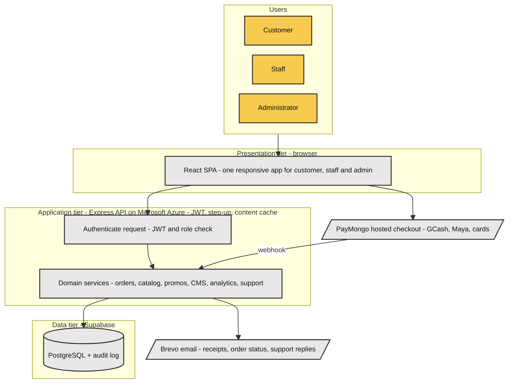

# Software Architecture — Figure 3.1.1 (capstone paper)

Canonical source for the paper's software architecture figure. Rendered PNG:
`C:\Users\USER\Downloads\architecture-diagram.png` — **1300 × 2352 px** (2× scale,
white background). On A4 portrait it prints ≈145 mm wide × 263 mm tall with body
text ≈7 pt; place it full-page with the caption *"Figure 3.1.1. Software
Architecture of the Whiskers Petshop Cross-Platform Ecosystem."*

## What the figure shows

Four vertical bands, top to bottom:

1. **Users** (yellow terminators) — Customer, Staff, Administrator.
2. **Presentation tier — browser** — the single React SPA that serves all three
   roles (responsive design + PWA install; there is no separate mobile app — the
   paper's Capacitor claim is removed per `paper-doc-updates.md` §1.2).
3. **Application tier — Express API on Microsoft Azure** — first the request
   authentication step (JWT + role check), then the domain services: orders,
   catalog, promos, CMS, analytics, support. Two external services sit beside
   this band:
   - **PayMongo** — hosted checkout for GCash, Maya, and cards; a labelled
     `webhook` edge returns the payment outcome to the services;
   - **Brevo** — transactional email (receipts, order status updates, support
     replies, password resets).
4. **Data tier — Supabase** — managed PostgreSQL with the audit log.

Flows: users act only on the SPA; the SPA calls the API over HTTPS/REST with a
JWT; the API talks to Supabase, Brevo, and the PayMongo seam. PayMongo's webhook
is the only inbound edge into the application tier besides the SPA.

## Deployment reality (matches `deploy/DEPLOY.md`)

- The API and the static frontend build run on a **Microsoft Azure virtual
  machine** (Azure for Students credit) using Docker Compose behind an HTTPS
  reverse proxy. The paper must say Azure, not Oracle, as the backend host
  (`paper-doc-updates.md` §1.4).
- **Supabase, Brevo, and PayMongo are managed third-party services.** The VM
  hosts only the API and the static files — never the database.
- The PayMongo edge is the production webhook; the prototype exercises the same
  transition rules through the built-in gateway simulation, and the live webhook
  is enabled once the deployment has a public HTTPS domain.

## Colors (capstone convention)

| Element | Fill | Stroke / text |
|---|---|---|
| Terminators (actor boxes) | `#F6CB4F` yellow | `#333333` 1.5 px, text `#111111` |
| Processes, I–O, database | `#E8E8E8` gray | `#333333` 1.5 px, text `#111111` |
| Background | white | — |

Tier bands (subgraph tint) are mermaid's default grouping color and carry no
semantic meaning.

## Mermaid source



## Re-render

```powershell
$dir = "C:\Users\USER\AppData\Local\Temp\opencode\flowcharts"
# save the block above verbatim to $dir\architecture.mmd (BOM-free)
npx -y @mermaid-js/mermaid-cli -i "$dir\architecture.mmd" -o "$dir\architecture.png" `
     -b white -p "$dir\puppeteer.json" -s 2
Copy-Item "$dir\architecture.png" "$env:USERPROFILE\Downloads\architecture-diagram.png" -Force
```

`puppeteer.json` points mermaid-cli at the installed Chrome:
`{"executablePath":"C:\\Program Files\\Google\\Chrome\\Application\\chrome.exe","args":["--no-sandbox","--disable-setuid-sandbox"]}`
(write it BOM-free with `[System.IO.File]::WriteAllText`).

Layout notes if the figure is ever edited: mermaid clusters are expensive
(~350–400 px of vertical space each in this graph) and `rankSpacing` tuning has
no measurable effect — prefer rewording labels over adding nodes or bands. The
current 1300 × 2352 render already fits A4 at readable size; do not add a fourth
tier band.
