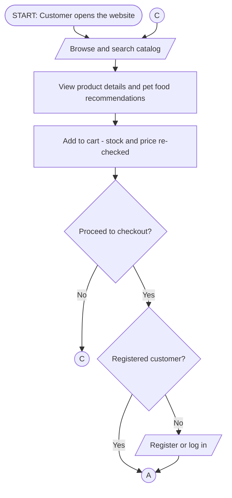
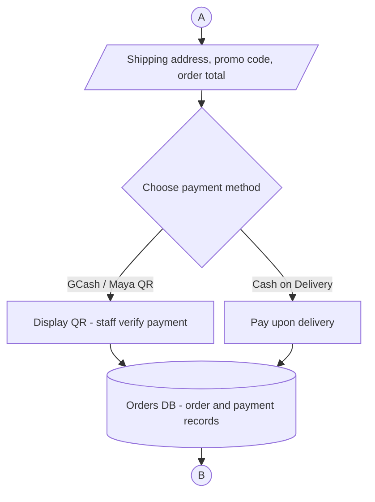
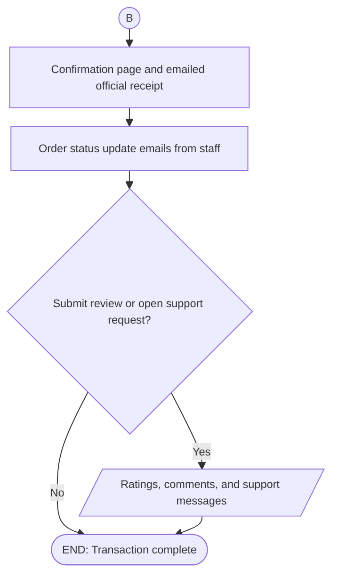
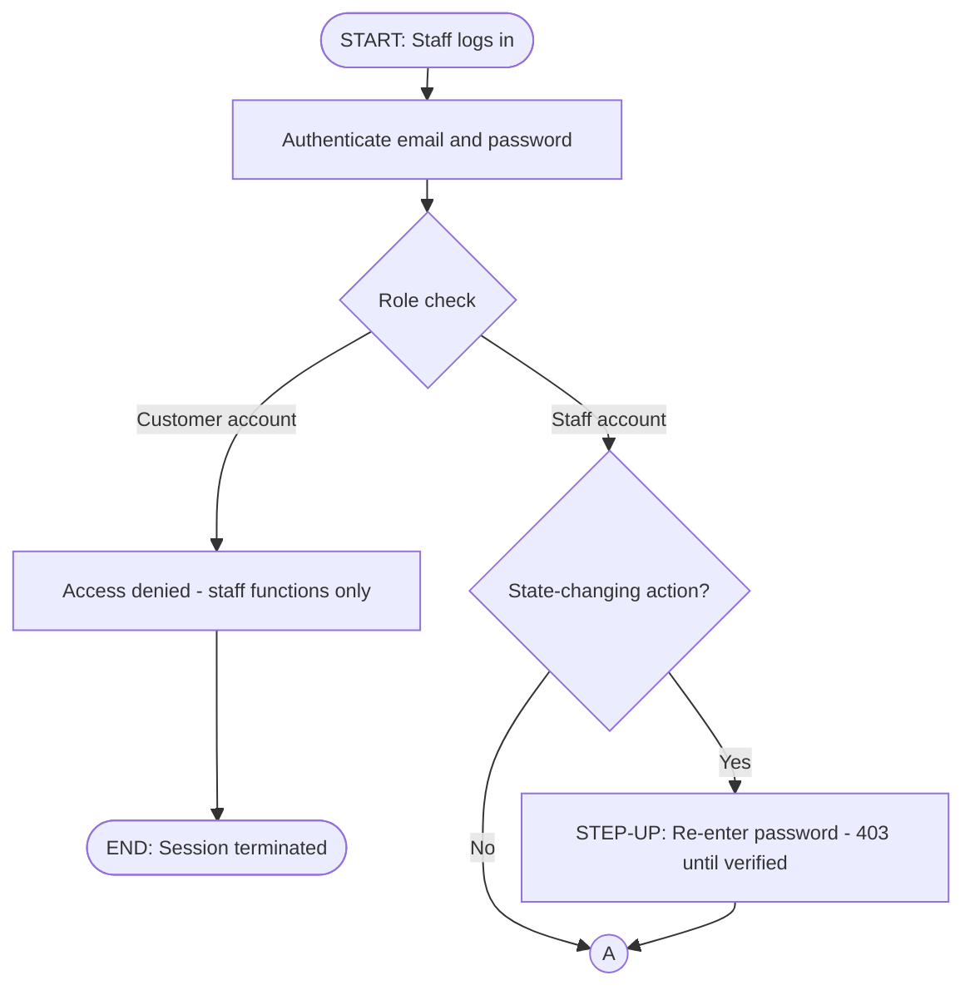
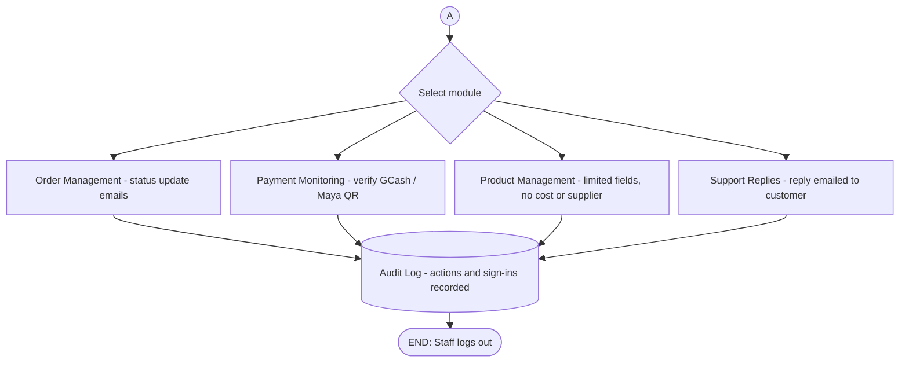
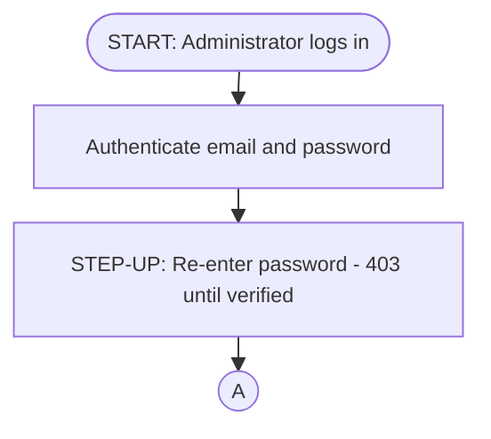
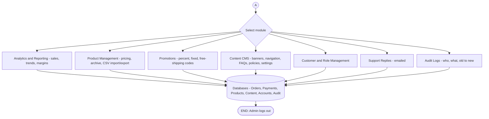

# System Flowcharts — Whiskers Petshop

Standard flowchart symbols used throughout:

| Shape | Meaning | Example |
|---|---|---|
| Stadium (rounded ends) | **Terminator** — Start / End | Start, Logout |
| Rectangle | **Process** — action by user or system | Compute totals, Update order status |
| Diamond | **Decision** — yes/no branch | Has an account? |
| Parallelogram | **Input / Output** — data entering or leaving | Enter pet data, Email receipt |
| Cylinder | **Database** — stored data | Orders DB, Products DB |
| Circle | **On-page connector** — flow continues at the matching letter | A, B |

**ANSI/ISO 5807 compliance:**

- Every path begins at a **Start terminator** and ends at an **End terminator** (no dead ends).
- Flow is strictly **top-to-bottom** — no reversed (upward) flowlines. Loops return via a circled on-page connector (customer connector **C** returns to *Browse*).
- Every decision has exactly **one entry and two labeled exits** (Yes/No).
- Flowlines never cross; merges are shown as multiple arrows entering one symbol.
- Text is horizontal, centered, and reads left-to-right.

**Print layout:** each figure is split into vertical columns so it fits A4 without shrinking the text. The flow leaves one column through a circled connector and resumes at the same letter at the top of the next column (customer uses A, B, and C; staff and admin use A). The stitched PNGs in `C:\Users\USER\Downloads\` are:

| File | Figure | Columns | Size (px) |
|---|---|---|---|
| `flowchart-customer.png` | Figure 3.3.6 — Customer | 3 (connectors A, B, C) | 2156 × 2356 |
| `flowchart-staff.png` | Figure 3.3.5 — Staff | 2 (connector A) | 2396 × 1968 |
| `flowchart-admin.png` | Figure 3.3.4 — Admin | 2 (connector A) | 2060 × 940 |

Paper figure numbering: **Figure 3.3.4 — Admin**, **Figure 3.3.5 — Staff**, **Figure 3.3.6 — Customer** (Chapters may renumber after re-shoot — keep this order).

---

## Customer Side (Figure 3.3.6)

Column 1 — browse to connector **A**:

(Connector **C** at the top of this column is where the *Proceed to checkout? — No* branch re-enters the flow to keep browsing — an ANSI-compliant alternative to an upward loop arrow.)

Column 2 — connector **A** to connector **B**:

Column 3 — connector **B** to end:

---

## Staff Side (Figure 3.3.5)

Column 1 — login to connector **A**:

Column 2 — connector **A** to end:

---

## Admin Side (Figure 3.3.4)

Column 1 — login to connector **A**:

Column 2 — connector **A** to end:

---

*Sources: these diagrams reflect the implemented system (single Express API, Supabase/Postgres, JWT + step-up, Brevo email). Each column is rendered separately with mermaid-cli (white background, scale 2) and stitched side by side — see the render notes in the repository history, or paste a block into https://mermaid.live for an editable view.*

---

## Figure descriptions (for Chapter III prose)

### Figure 3.3.6. System Flowchart — Customer

The customer flow begins when the user opens the Whiskers Petshop website and browses the product catalog through search, brand, or category filters. Selecting a product displays its full details — description, ingredients, feeding guide, price, and stock availability. The customer may optionally set up a pet profile by entering the pet's health condition, allergies, and dietary needs; this input is processed by the rule-based recommendation engine, which returns suitable food products for that pet. Items are added to the cart, where the system re-checks stock availability and the current price before the customer proceeds to checkout. An account is required to complete a purchase, so unregistered users are directed to register or log in. At checkout, the customer enters a shipping address and contact number, optionally applies a promo code (validated for type, limits, and validity window), and the system computes the order total, adding the shipping fee unless the free-shipping threshold is met. Two payment paths are offered: GCash/Maya QR transfer, where the payment instructions are displayed and verified by store staff before fulfillment, and cash on delivery, where payment is collected upon receipt of the order. Once the order is recorded, the confirmation page is displayed and an official receipt is emailed to the customer. Order status updates are emailed as staff process the order. Finally, the customer may rate a purchased product from 1 to 5 stars and may open a support request, to which staff replies by email.

### Figure 3.3.5. System Flowchart — Staff

The staff flow begins with authentication using the staff account's email and password, verified through Supabase JWT tokens. The system validates the credentials and checks the account's role, restricting access to staff functions only — cost prices, suppliers, and role management are hidden from this role. Before any state-changing action (such as changing an order status or editing a product), the system enforces step-up re-verification: the staff member must re-enter their password and receives an HTTP 403 response until this confirmation is satisfied, protecting the account against unauthorized use. The staff member then selects a module from the dashboard. In **Order Management**, orders are viewed and their statuses updated, which automatically emails a status notification to the customer. In **Payment Monitoring**, GCash/Maya QR payments submitted by customers are checked and confirmed, releasing the order for fulfillment. In **Product Management**, staff may add or edit product records — name, description, price, stock quantity, and images — which are written to the Products Database; cost and supplier fields remain restricted to administrators. In **Support Replies**, staff read and reply to customer requests, with the reply delivered to the customer's email. Staff may also view the content published by the administrator. Every action and sign-in is recorded in the audit log, and the flow ends when the staff member logs out.

### Figure 3.3.4. System Flowchart — Administrator

The administrator flow begins with authentication and the same step-up password re-verification required before any state-changing action. From the dashboard, the administrator selects from ten modules. **Analytics and Reporting** queries the orders, payments, and events data to produce sales figures, product trends, and margins computed from the per-line cost snapshots, displayed on the dashboard and in reports. **Product Management** allows creating, editing, pricing, archiving, and restoring products, with automatic price history and CSV import/export, written to the Products Database. **Promotions** lets the administrator create and manage promo codes — percentage, fixed-amount, or free-shipping — with scopes, usage limits, and validity windows. The **Content Management System** covers banners, home sections, navigation, frequently asked questions, and policy pages, while **Site Settings** holds the shipping fee, free-shipping threshold, payment methods with QR images, and the maintenance mode switch; every content change invalidates the server cache so shoppers see the update on their next visit. **Customer and Role Management** allows viewing customers and changing account roles (user, staff, admin). **Support Replies** delivers responses to customers by email. Finally, **Audit Logs** displays the complete audit trail — who changed what, from which old value to which new value, including all sign-in records. Every administrator write is recorded before the session ends at logout.
